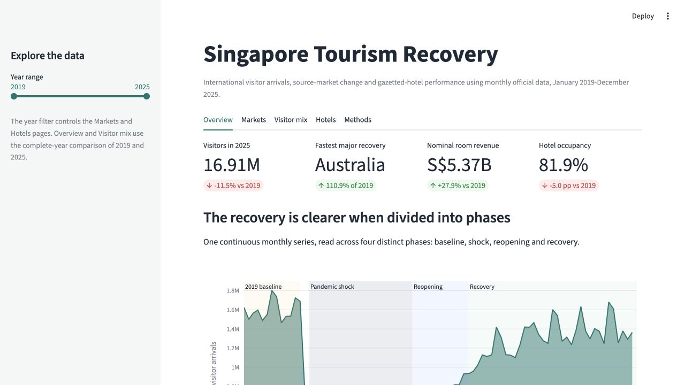

# Singapore Inbound Tourism and Hotel Recovery Dashboard

This DS608 group project examines how Singapore's international visitor arrivals recovered after the COVID-19 disruption and whether the recovery aligned with gazetted-hotel occupancy, room rates and room revenue.

**Team:** Jiang Minglan and Gou Hongyu

**Live dashboard:** [Singapore Tourism Recovery](https://singapore-tourism-recovery.streamlit.app/)

The dashboard is interactive. Open the live application above, or run `app.py`
locally for filters, hover details and the complete set of storytelling tabs.

## Dashboard preview



## Research question

How did international visitor arrivals from major source markets recover relative to 2019, and how closely did this recovery align with Singapore's gazetted-hotel performance between 2019 and 2025?

## Dashboard features

- Follow a guided recovery story across four analytical phases: 2019 baseline,
  pandemic shock, 2022 reopening and 2023-2025 recovery.
- Select a year range from 2019 to 2025.
- Compare multiple source markets.
- View monthly arrivals and a same-month 2019 recovery index.
- Rank recovery among the 15 largest source markets in 2019.
- Compare the 2019 and 2025 visitor mix and changes in market share.
- Examine hotel occupancy, nominal average room rates and nominal room revenue.
- Compare the recovery and monthly correlation of total arrivals and nominal hotel room revenue.
- Read interpretation and causality cautions alongside the charts.
- Download filtered visitor and hotel data.

## Data sources

1. [International Visitor Arrivals By Place Of Residence, Monthly](https://data.gov.sg/datasets/d_7e7b2ee60c6ffc962f80fef129cf306e/view), Singapore Department of Statistics. Original source: Singapore Tourism Board.
2. [Hotel Statistics, Monthly](https://data.gov.sg/datasets/d_8e62605f0c1c948702b6ea0fe45242d3/view), Singapore Department of Statistics. Original source: Singapore Tourism Board.

The dataset originally linked during topic exploration is the hotel-statistics table. It is combined with the visitor-arrivals table to support both demand-side and hotel-sector analysis.

The source datasets are governed by the
[Singapore Open Data Licence](https://data.gov.sg/privacy-and-terms). This project
reports aggregated monthly statistics and does not use personal data.

## Repository structure

```text
singapore-tourism-dashboard/
├── README.md
├── AI_USAGE.md
├── CONTRIBUTIONS.md
├── app.py
├── requirements.txt
├── data/
│   ├── raw/
│   └── processed/
├── docs/
│   └── PROJECT_PROPOSAL.md
├── src/
│   ├── analysis.py
│   ├── plots.py
│   └── wrangle.py
├── outputs/
│   ├── figures/
│   ├── presentation/
│   └── tables/
└── tests/
    ├── test_analysis.py
    └── test_processed_data.py
```

## Setup

Create and activate a virtual environment:

```bash
python3 -m venv .venv
source .venv/bin/activate
```

Install the required libraries:

```bash
pip install -r requirements.txt
```

## Rebuild the processed data

From the repository root, run:

```bash
python src/wrangle.py
```

The script downloads the official API responses, reshapes the wide source tables, validates required columns, consistent monthly dates, complete 2019-2025 coverage, numeric values, required categories and unique keys, then writes processed CSV files to `data/processed/`. It stops with a descriptive error instead of exporting data with missing, infinite or negative measure values.

## Run the dashboard

```bash
streamlit run app.py
```

## Run the tests

```bash
python -m pytest
```

## Streamlit deployment

The dashboard is deployed on Streamlit Community Cloud at
[singapore-tourism-recovery.streamlit.app](https://singapore-tourism-recovery.streamlit.app/).
To run the app locally, use the command above after installing the requirements.

The deployment uses `app.py` as the main file. The processed CSV files are included so the dashboard does not depend on a live API request during each page load.

## Code organisation

Each Python module has one main objective:

- `src/wrangle.py` downloads, reshapes and validates the official data, then writes
  reproducible processed files.
- `src/analysis.py` contains reusable calculations for recovery indices, annual
  comparisons, visitor mix, hotel summaries and correlation.
- `src/plots.py` contains reusable Plotly chart builders and shared chart styling.
- `app.py` loads the processed data and connects the analysis and charts to the
  Streamlit interface.

This separation keeps data preparation, calculations, visualisation and UI logic
independently testable and easier to explain.

## Methodology

The visitor-arrival source is hierarchical: it contains an overall total, geographic regions and individual source markets. The wrangling script preserves those levels so that regional totals are not accidentally added to country totals. It also checks that dates are month starts, the year and month columns agree with each date, all months from January 2019 through December 2025 are present, and measure values are finite and non-negative.

The dashboard uses two recovery measures. The monthly measure compares each month
with the same calendar month in 2019:

```text
Recovery index = monthly value / value in the same month of 2019 × 100
```

An index of 100 means the series returned to its matching 2019 level. A value below 100 means it remained below that level, while a value above 100 means it exceeded the 2019 level.

The annual market ranking divides each market's 2025 annual arrivals by its 2019
annual arrivals. The ranking is limited to the 15 largest markets in 2019 so that a
very small starting value does not produce a misleading "fastest recovery" result.
Visitor composition is measured as each country market's share of all country-market
arrivals. The descriptive correlation compares the two same-month 2019 recovery
indices over the selected period; it does not establish causality.

The four phases shown in the dashboard are an analytical storytelling framework,
not an official government classification. They roughly align with the 2019
baseline, the March 2020-2021 pandemic shock, reopening during 2022 and continued
recovery from 2023 to 2025. Annual hotel occupancy and room rate are reported as
the arithmetic mean of the 12 published monthly observations; annual room revenue
is the sum of the monthly values.

## Key findings

The processed official data currently show:

- Singapore recorded 16.91 million international visitor arrivals in 2025, equal to 88.5% of the 2019 total of 19.12 million.
- China was the largest individual source market in 2025 with 3.10 million arrivals, followed by Indonesia with 2.44 million.
- Among the 15 largest 2019 source markets, Australia had the highest 2025 recovery rate at 110.9%, followed by Malaysia at 104.5%.
- Australia's share of country-market arrivals increased by 1.51 percentage points between 2019 and 2025, while Indonesia's share decreased by 1.85 percentage points.
- Average hotel occupancy was 81.9% in 2025, around 5.0 percentage points below the 2019 average.
- The average room rate was S$273 in 2025, 23.7% above the 2019 average in nominal terms.
- Nominal hotel room revenue reached S$5.37 billion in 2025, 27.9% above 2019 even though total visitor arrivals had not fully returned to the 2019 level.

These are descriptive results. Higher nominal room rates and revenue should not be interpreted as proof that visitor recovery caused hotel performance, and the monetary figures have not been adjusted for inflation.

## Final outputs

- [Live Streamlit dashboard](https://singapore-tourism-recovery.streamlit.app/)
- [Final presentation slides](outputs/presentation/DS608_Singapore_Tourism_Final.pptx)
- [Dashboard preview](outputs/figures/dashboard_overview.jpg)
- Summary tables in `outputs/tables/`

## Limitations

- Source markets are based on place of residence rather than nationality.
- Hotel indicators refer to gazetted hotels, not every accommodation provider.
- Room rates and room revenue are nominal and are not adjusted for inflation.
- Monthly aggregated data cannot identify individual visitor behaviour or establish causality.
- Recovery can also reflect flight capacity, border policy, exchange rates and major events that are outside the current model.
- The processed project period ends in December 2025 to retain complete calendar years.

## Group work

This project was prepared for DS608 Data Analytics for Economics as a group project. Individual responsibilities are documented in `CONTRIBUTIONS.md`, and the use of generative AI is documented in `AI_USAGE.md`.
